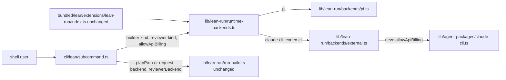

# Lean CLI flags: --reviewer-backend, --request, --allow-api-billing

## Approach
Add three flags to `cosmonauts lean build|review` in `cli/lean/subcommand.ts`, wiring each one to machinery that already exists.

`--reviewer-backend <kind>` (build only) picks the harness for the reviewer stages. It uses the same choices as `--backend` and has no default, so leaving it out means the `--backend` kind. `runBuild` already accepts a separate `reviewerBackend`. `runtimeBackends` should build one backend per distinct kind, return the same backend for both roles when the kinds match, and keep today's behavior for its existing two-argument call, which the `lean_build` and `lean_review` tools use.

`--request <text>` makes `--plan` optional on build and requires exactly one of the two. A blank request is refused with the same rules and messages the tool uses. On review, `--request` is context for the reviewer and cannot be combined with `--plan`.

`--allow-api-billing` (build and review) is passed through backend creation to `createExternalBuilderBackend`. That function passes it to `createClaudeCliInvocation`, which already keeps `ANTHROPIC_API_KEY` when the option is set. The flag does nothing for codex-cli and pi.

Update the `--backend` help to say that it picks the builder's harness and the reviewer's default. Update the hand-off line in the lean skill.

The Contract tests below are already in the tree, and the obligations are red. Make them green without editing them. If one looks wrong, leave it as it is and say why in the notes. Keep every pin green.

Add your own implementation tests, including one in `tests/lean-run/backends.test.ts` showing that the option reaches `claude`'s environment, so that mutation can kill mutants in `external.ts`.

Keep notes in `missions/lean/cli-flags/notes.md`:
- every choice this plan does not settle, with its alternatives and the reason for your pick;
- every discovery, as one sentence plus the test that shows it.

Do not touch `lib/lean-run/run-build.ts` or the lean-run extension. Use no em or en dashes in added lines.

## Touches
- `cli/lean/subcommand.ts`: adds the three options, makes `--plan` optional on build with the one-of check, passes `request`, resolves both backend kinds, and updates the help text
- `lib/lean-run/runtime-backends.ts`: creates the builder and reviewer backends for two kinds, passing `allowApiBilling` to the external ones; the tools' call keeps working unchanged
- `lib/lean-run/backends/external.ts`: adds an `allowApiBilling` option to `ExternalBuilderBackendOptions`, passed into `createClaudeCliInvocation` in `materialize`
- `tests/cli/lean/subcommand.test.ts`: holds the Contract tests already; the builder's own CLI cases go here too
- `tests/lean-run/backends.test.ts`: adds a backend-level case showing the key is kept with `allowApiBilling` and removed without it
- `tests/lean-run/runtime-backends.test.ts`: adds a case for distinct builder and reviewer kinds, and one for a single kind
- `external-skills/cosmonauts-lean/SKILL.md`: updates the hand-off command line with the new flags

## Reuses
- `lib/agent-packages/claude-cli.ts`: `createClaudeCliInvocation` and `buildChildEnv` already honor `allowApiBilling`; no change
- `lib/lean-run/run-build.ts`: `RunBuildOptions.request` and `reviewerBackend`, and `RunReviewOptions.request`; no change
- `bundled/lean/extensions/lean-run/index.ts`: the tools' plan-or-request check and its messages, the model for the CLI's check; it must keep calling `createBackends(kind, cwd)` as today
- `lib/lean-run/types.ts`: `LEAN_BACKEND_KINDS` for the choices, and `LEAN_ROLES`
- `tests/lean-run/external-backends-pi-free.test.ts`: the pattern for building real backends through `runtimeBackends` without loading Pi

## Behaviors
- B-1: a user at the shell / `cosmonauts lean build --request "<text>" --backend claude-cli` / a direct-tier run of that text starts with no plan file, and run.json says tier direct
- B-2: a user at the shell / `cosmonauts lean build` with both `--plan` and `--request`, with neither, or with a blank request / exit 1 with one error naming the problem, and no run starts
- B-3: a user at the shell / `cosmonauts lean review --request "<text>"` / the reviewer reads the change against that text
- B-4: a user at the shell / `cosmonauts lean build --backend claude-cli --reviewer-backend codex-cli` / the builder stages run in Claude Code and the reviewer stages in Codex
- B-5: a user at the shell / `cosmonauts lean build --backend codex-cli` with no reviewer backend / builder and reviewer both run in Codex, as today
- B-6: the account that pays / `cosmonauts lean build` or `review` with `--backend claude-cli --allow-api-billing` and ANTHROPIC_API_KEY set / every Claude Code session keeps the key; without the flag the key is removed, as today
- B-7: a lead session / the `lean_build` and `lean_review` tools / backend choice and the pi default behave exactly as before
- B-8: a user at the shell / `cosmonauts lean build --help` / the help names the three flags and says `--backend` picks the builder and the default reviewer

## Risks
- Mutation is capped at 300 s and `run-build.test.ts` alone takes about 2 minutes, so any change to `run-build.ts` would time mutation out. Stay out of it.
- `runtimeBackends` is shared with the tools. A changed signature that breaks `createBackends(kind, cwd)` breaks lead sessions. The tool tests pin this.
- A reviewer kind of `pi` loads Pi in-process. A builder on claude-cli with a codex-cli reviewer must still load no Pi.
- `--request` takes a value, so in `--request --json`, the `--json` becomes the request text. The `jsonFlagGiven` function reads `option.required`, so the new options are handled, but check it.
- The Contract tests predate the run, so they are not in the reviewer's diff. The Contract section below names them.
- The default stays `pi` (R-3). One forgotten `--backend` still reaches the work account.

## Diagram

## Contract
All in `tests/cli/lean/subcommand.test.ts` unless named otherwise. Reasons and one-line assertions are in the trial's `trial-contract.md`.

Pins, green before the change and kept green:
- N-1 `lean review` "defaults the reviewer backend to pi"
- N-2 `lean build` "runs the reviewer on the --backend harness when no reviewer backend is given"
- N-3 `lean build` "launches claude-cli sessions without ANTHROPIC_API_KEY by default"
- N-4 `lean review` "launches the claude-cli reviewer without ANTHROPIC_API_KEY by default"
- Existing:
  - `subcommand.test.ts:297`, `:327`, `:406`, `:436`, `:493`
  - `tests/lean-run/external-backends-pi-free.test.ts:43`
  - `tests/lean-run/lean-build-tool.test.ts:606`, `:629`, `:724`
  - `tests/agent-packages/claude-cli.test.ts:136`, `:153`
  - `tests/lean-run/backends-model.test.ts:258`

Obligations, red before the change:
- O-1 `lean build` "runs a direct request given --request and no --plan"
- O-2 `lean build` "refuses --plan with --request, and neither, before any run"
- O-3 `lean build` "refuses a blank --request before any run"
- O-4 `lean review` "passes --request to the run as the change's context" and "refuses --plan with --request before any run"
- O-5 `lean build` "runs the reviewer on --reviewer-backend and the builder on --backend"
- O-6 `lean build` "refuses an unknown --reviewer-backend before any run"
- O-7 `lean build` "keeps ANTHROPIC_API_KEY in claude-cli sessions with --allow-api-billing"
- O-8 `lean review` "keeps ANTHROPIC_API_KEY in the claude-cli reviewer with --allow-api-billing"
- O-9 `lean build` "documents --request, --reviewer-backend and --allow-api-billing in its help", plus the hand-off line in `external-skills/cosmonauts-lean/SKILL.md`
