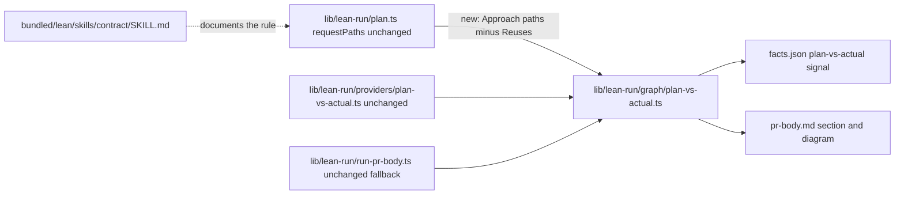

# Plan-vs-actual: count files the Approach names as planned

## Approach
The plan-vs-actual signal compares the plan with what changed. Today it reads only `## Touches`, so a changed file that the plan asks for in its Approach is reported as unplanned. Change `planVersusActual` in `lib/lean-run/graph/plan-vs-actual.ts` so that a changed file the Approach names also counts as planned.

The rule, settled in R-1:
- the Approach's paths are read by the rule `requestPaths` already uses for a direct request: backticked path-like spans, plus bare words with a directory and an extension, never a URL, and with any `:line` suffix dropped;
- each one is matched as an exact file after normalization, so a directory or a glob named in prose covers nothing;
- a path that `## Reuses` lists never becomes planned this way, but a path that `## Touches` lists stays planned as before;
- an Approach-only path is never listed as untouched;
- every other section plans nothing.

Put the rule in `planVersusActual` itself, not in the provider. That way the provider and the PR body's fallback, which both pass the whole parsed plan, give the same lists. Existing callers pass `plan: { touches }` only, and those calls must still type-check.

Update the Touches line of the plan template in `bundled/lean/skills/contract/SKILL.md`. Say there that files the Approach names also count as planned unless Reuses lists them, so forbidden files belong in Risks or Reuses.

The Contract tests below are already in the tree, and the obligations are red. Make them green without editing them. If one looks wrong, leave it as it is and say why in the notes. Keep every pin green. Add your own tests of `planVersusActual` to `tests/lean-run/graph/plan-vs-actual.test.ts`, which mutation runs first.

Keep notes in `missions/lean/plan-vs-actual-prose/notes.md`:
- every choice this plan does not settle, with its alternatives and the reason for your pick (for example, paths inside a fenced block in the Approach);
- every discovery, as one sentence plus the test that shows it.

Use no em or en dashes in added lines.

## Touches
- `lib/lean-run/graph/plan-vs-actual.ts`: `planVersusActual` also counts changed files the Approach names as planned, except those Reuses lists; untouched still lists only Touches entries; the `{ touches }`-only call keeps working
- `tests/lean-run/graph/plan-vs-actual.test.ts`: the builder's own tests of `planVersusActual`, the mirrored test that mutation runs first
- `bundled/lean/skills/contract/SKILL.md`: the Touches line of the plan template states the rule

## Reuses
- `lib/lean-run/plan.ts`: `requestPaths`, the prose-path rule a direct request already uses; no change
- `lib/lean-run/graph/paths.ts`: `normalizeRepoPaths`; no change
- `lib/lean-run/providers/plan-vs-actual.ts`: already passes the whole parsed plan; no change
- `lib/lean-run/run-pr-body.ts`: its fallback already passes the whole plan to `planVersusActual`; no change
- `tests/lean-run/providers/context.ts`: `stubContext`, used by the Contract tests

## Behaviors
- B-1: lean's reviewer / the plan-vs-actual signal of a run whose plan Approach says "Keep notes in `missions/x/notes.md`" and whose builder writes that file / the notes file is listed planned, not unplanned
- B-2: lean's reviewer / the plan-vs-actual signal when a changed file is named only in Reuses, Risks, Behaviors or another section / the file is still listed unplanned
- B-3: lean's reviewer / the plan-vs-actual signal when the Approach says "do not touch" a file that Reuses also lists, and the builder changes it / the file is still listed unplanned
- B-4: lean's reviewer / the plan-vs-actual signal when the Approach names a file the change never touches / the file is not listed untouched
- B-5: a reader of the PR / the Plan versus actual section and the change diagram in pr-body.md / they show the same lists as the signal, with no "(unplanned)" label on a file the Approach asked for
- B-6: a plan writer / the plan template in the contract skill / it says which prose paths count as planned and where forbidden files go

## Risks
- **Mutation and `run-build.test.ts`.** At `8a4b1419`, lean's mutation selection for this file includes `tests/lean-run/run-build.test.ts`, which alone takes about 2 minutes, and lean's Stryker run then exceeds its 300 s cap. That is settled before this run starts. Do not work around it from inside this change.
- **Do not change `lib/lean-run/run-build.ts`, `lib/lean-run/plan.ts` or `.cosmonauts/config.json`.** The first would time mutation out. The second widens the blast radius for no gain. The third trips a digest test.
- **Negative mentions.** "Do not touch `x`" in an Approach now plans `x`, unless Reuses lists it. This plan names forbidden files here in Risks for that reason.
- **The public call.** `planVersusActual` is exported from `lib/lean-run/index.ts`, and the graph tests call it with `plan: { touches }`. Keep the new plan fields optional so those calls still type-check, since `bun run typecheck` covers `tests/`.
- **This run will flag its own notes file.** The run's host checks are the base code, so plan-vs-actual will list `missions/lean/plan-vs-actual-prose/notes.md` as unplanned. That is the defect being fixed, not a finding.
- **The Contract tests predate the run,** so they are not in the reviewer's diff. The Contract section below names them.
- **No plan, no change.** The direct tier and a review without a plan keep their "no plan" result.

## Diagram

## Contract
All of these are in `tests/lean-run/providers/plan-vs-actual.test.ts`, describe "planVersusActualProvider reading the plan text", unless named otherwise. The reasons and the one-line assertions are in the trial's `trial2-contract.md`.

Pins, green before the change and kept green:
- N-1 "counts a changed file named only in Reuses as unplanned"
- N-2 "counts a changed file named only in %s as unplanned" (Risks, Behaviors, Contract, Notes)
- N-3 "never lists a path named only in Approach as untouched"
- N-4 "does not let a directory or glob named in Approach cover the files under it"
- N-5 "keeps a changed file unplanned when Approach names it and Reuses lists it"
- N-6 "keeps a Touches path planned when Reuses names it too"
- Existing:
  - `tests/lean-run/graph/plan-vs-actual.test.ts`, every test; do not edit
  - `tests/lean-run/providers/plan-vs-actual.test.ts:12`, `:34`, `:58`, `:72`
  - `tests/lean-run/plan.test.ts:48`, `:54`, `:62`, `:126`, `:139`, `:162` to `:197`
  - `tests/lean-run/run-build.test.ts:4136`, `:4170`

Obligations, red before the change:
- O-1 "counts a changed file named in backticks in Approach as planned"
- O-2 "counts a changed file named bare in Approach, with a directory and an extension, as planned"
- O-3 "reads an Approach path with ./ or a :line suffix as the file"
- O-4 the Touches line in `bundled/lean/skills/contract/SKILL.md` states the rule; checked by the reviewer

Added in the fix round, from review finding R1:
- A URL the Approach names, backticked or bare, plans nothing: a changed file at the URL's normalized path (`https:/x.dev/lib/a.ts`) stays unplanned. Pinned by "does not read a URL in the Approach as a path" in `tests/lean-run/graph/plan-vs-actual.test.ts`.
